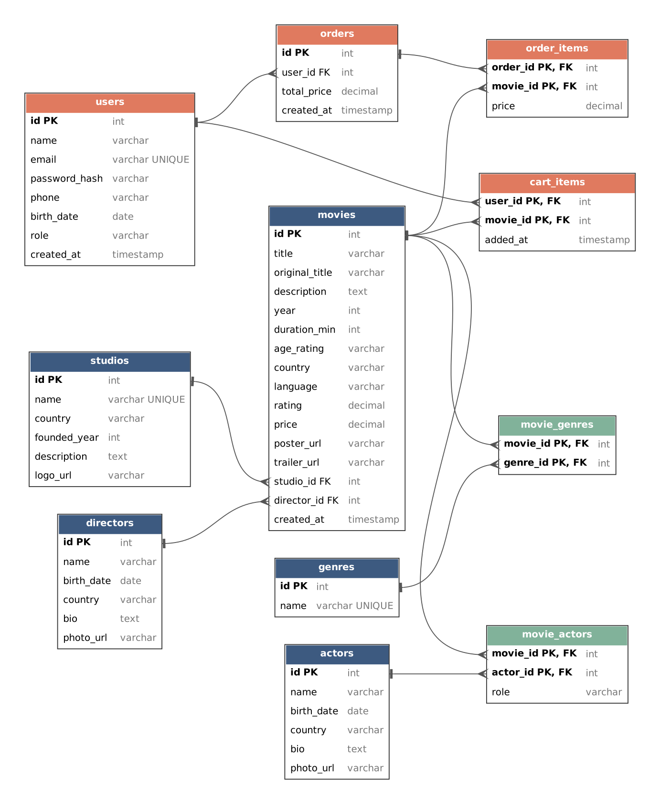

# 🎬 КіноПолиця

> Онлайн-магазин фільмів: знаходь, обирай і купуй фільми, щоб дивитися їх онлайн.

---

## 📖 Зміст

- [Про проєкт](#-про-проєкт)
- [Сторінки сайту](#-сторінки-сайту)
- [Загальні правила API](#-загальні-правила-api)
- [Ендпоінти](#-ендпоінти)
  - [Фільми](#-фільми)
  - [Жанри](#-жанри)
  - [Режисери](#-режисери)
  - [Актори](#-актори)
  - [Кіностудії](#-кіностудії)
  - [Реєстрація та вхід](#-реєстрація-та-вхід)
  - [Профіль](#-профіль)
  - [Кошик](#-кошик)
  - [Замовлення](#-замовлення)
  - [Про нас](#ℹ️-про-нас)
- [Схема бази даних](#-схема-бази-даних)

---

## 💡 Про проєкт

**КіноПолиця** — це сайт, де можна купити фільм і додати його до своєї особистої колекції.

Що можна робити на сайті:

- переглядати **каталог фільмів**, шукати фільм за назвою, режисером або актором;
- фільтрувати фільми за **жанром**, **кіностудією** та **роком виходу**;
- сортувати фільми **від найдешевших**, **від найдорожчих**, **за популярністю**, **за рейтингом** та **за роком**;
- відкрити **сторінку фільму** з детальною інформацією: опис, рік, тривалість, вікове обмеження, країна, рейтинг, трейлер, режисер, актори, жанри, студія, ціна;
- переглядати **режисерів**, **акторів** та **кіностудії** і бачити всі їхні фільми, які є на сайті;
- **зареєструватися** та **увійти** в акаунт;
- у **профілі** бачити історію своїх замовлень і редагувати дані про себе;
- додавати фільми в **кошик** і натиснути «Купити», щоб створилось **замовлення** (без оплати та додаткових даних — це спрощення);
- адміністратор може **додавати, редагувати та видаляти** фільми, жанри, режисерів, акторів і студії;
- сторінка **«Про нас»** з контактами та інформацією про доступ до фільмів і повернення коштів.

> Фільми цифрові, тому кожен фільм можна купити лише один раз — кількості в кошику немає.

---

## 🗺 Сторінки сайту

| Сторінка | Що на ній є |
|---|---|
| Головна / Каталог | Список фільмів, пошук, фільтри, сортування |
| Сторінка фільму | Уся інформація про фільм, кнопка «В кошик» |
| Режисери | Список режисерів |
| Сторінка режисера | Біографія та всі його фільми |
| Актори | Список акторів |
| Сторінка актора | Біографія та всі фільми з ним |
| Кіностудії | Список студій |
| Сторінка студії | Опис та всі фільми студії |
| Реєстрація / Вхід | Форми реєстрації та входу |
| Профіль | Дані користувача, історія замовлень |
| Кошик | Обрані фільми, загальна сума, кнопка «Купити» |
| Про нас | Контакти, доступ до фільмів, повернення коштів |

---

## ⚙️ Загальні правила API

- Базова адреса: `/api`
- Усі дані передаються у форматі **JSON**.
- Списки підтримують пагінацію через query-параметри `page` (за замовчуванням `1`) та `limit` (за замовчуванням `20`).
- Відповідь зі списком має такий вигляд:

```json
{
  "items": [ ... ],
  "page": 1,
  "limit": 20,
  "total": 134
}
```

- Помилки повертаються у форматі:

```json
{
  "error": "Movie not found"
}
```

### Статуси відповідей

| Статус | Коли |
|---|---|
| `200 OK` | Успішний запит |
| `201 Created` | Ресурс створено |
| `204 No Content` | Ресурс видалено, тіла відповіді немає |
| `400 Bad Request` | Неправильні дані в запиті |
| `401 Unauthorized` | Користувач не залогінений |
| `403 Forbidden` | Немає прав (наприклад, не адміністратор) |
| `404 Not Found` | Ресурс не знайдено |
| `409 Conflict` | Конфлікт (email вже зайнятий, фільм уже в кошику тощо) |

### Доступ

| Позначка | Хто може викликати |
|---|---|
| 🌍 | Усі |
| 🔒 | Тільки залогінений користувач |
| 🛠 | Тільки адміністратор |

> **TODO:** авторизацію буде додано пізніше. TBD: обговорити, як саме передавати дані про залогіненого користувача (токен чи сесія).

---

## 🔌 Ендпоінти

### Коротко

| Метод | Ендпоінт | Опис | Доступ |
|---|---|---|---|
| `GET` | `/api/movies` | Список фільмів (пошук, фільтри, сортування) | 🌍 |
| `GET` | `/api/movies/{id}` | Сторінка фільму | 🌍 |
| `POST` | `/api/movies` | Додати фільм | 🛠 |
| `PUT` | `/api/movies/{id}` | Редагувати фільм | 🛠 |
| `DELETE` | `/api/movies/{id}` | Видалити фільм | 🛠 |
| `GET` | `/api/genres` | Список жанрів | 🌍 |
| `POST` | `/api/genres` | Додати жанр | 🛠 |
| `PUT` | `/api/genres/{id}` | Редагувати жанр | 🛠 |
| `DELETE` | `/api/genres/{id}` | Видалити жанр | 🛠 |
| `GET` | `/api/directors` | Список режисерів | 🌍 |
| `GET` | `/api/directors/{id}` | Сторінка режисера | 🌍 |
| `GET` | `/api/directors/{id}/movies` | Фільми режисера | 🌍 |
| `POST` | `/api/directors` | Додати режисера | 🛠 |
| `PUT` | `/api/directors/{id}` | Редагувати режисера | 🛠 |
| `DELETE` | `/api/directors/{id}` | Видалити режисера | 🛠 |
| `GET` | `/api/actors` | Список акторів | 🌍 |
| `GET` | `/api/actors/{id}` | Сторінка актора | 🌍 |
| `GET` | `/api/actors/{id}/movies` | Фільми з актором | 🌍 |
| `POST` | `/api/actors` | Додати актора | 🛠 |
| `PUT` | `/api/actors/{id}` | Редагувати актора | 🛠 |
| `DELETE` | `/api/actors/{id}` | Видалити актора | 🛠 |
| `GET` | `/api/studios` | Список кіностудій | 🌍 |
| `GET` | `/api/studios/{id}` | Сторінка студії | 🌍 |
| `GET` | `/api/studios/{id}/movies` | Фільми студії | 🌍 |
| `POST` | `/api/studios` | Додати студію | 🛠 |
| `PUT` | `/api/studios/{id}` | Редагувати студію | 🛠 |
| `DELETE` | `/api/studios/{id}` | Видалити студію | 🛠 |
| `POST` | `/api/auth/register` | Реєстрація | 🌍 |
| `POST` | `/api/auth/login` | Вхід | 🌍 |
| `POST` | `/api/auth/logout` | Вихід | 🔒 |
| `GET` | `/api/users/me` | Мій профіль | 🔒 |
| `PUT` | `/api/users/me` | Редагувати профіль | 🔒 |
| `GET` | `/api/users/me/orders` | Історія замовлень | 🔒 |
| `GET` | `/api/users/me/orders/{id}` | Одне замовлення | 🔒 |
| `GET` | `/api/cart` | Мій кошик | 🔒 |
| `POST` | `/api/cart/items` | Додати фільм у кошик | 🔒 |
| `DELETE` | `/api/cart/items/{movieId}` | Прибрати фільм з кошика | 🔒 |
| `DELETE` | `/api/cart` | Очистити кошик | 🔒 |
| `POST` | `/api/orders` | Купити (створити замовлення з кошика) | 🔒 |
| `GET` | `/api/about` | Інформація «Про нас» | 🌍 |

---

### 🎞 Фільми

#### `GET /api/movies` 🌍

Список фільмів для каталогу. Підтримує пошук, фільтри, сортування та пагінацію.

**Query-параметри** (усі необовʼязкові):

| Параметр | Тип | Опис |
|---|---|---|
| `search` | string | Пошук за назвою фільму, імʼям режисера або актора |
| `genreId` | number | Фільтр за жанром |
| `studioId` | number | Фільтр за кіностудією |
| `yearFrom` | number | Рік виходу від |
| `yearTo` | number | Рік виходу до |
| `sort` | string | `price_asc`, `price_desc`, `popularity`, `rating`, `year_desc` |
| `page` | number | Номер сторінки |
| `limit` | number | Кількість фільмів на сторінці |

Приклад: `GET /api/movies?search=nolan&genreId=3&sort=price_asc&page=1`

**Response:** `200 OK`

```json
{
  "items": [
    {
      "id": 1,
      "title": "Початок",
      "year": 2010,
      "posterUrl": "https://example.com/posters/inception.jpg",
      "price": 149.00,
      "rating": 8.8,
      "genres": [{ "id": 3, "name": "Фантастика" }],
      "director": { "id": 5, "name": "Крістофер Нолан" }
    }
  ],
  "page": 1,
  "limit": 20,
  "total": 1
}
```

> Популярність рахується як кількість покупок фільму. TBD: рахувати під час запиту чи зберігати окремим полем.

---

#### `GET /api/movies/{id}` 🌍

Детальна інформація для сторінки фільму.

**Response:** `200 OK`

```json
{
  "id": 1,
  "title": "Початок",
  "originalTitle": "Inception",
  "description": "Кобб — талановитий злодій, який краде секрети з підсвідомості людей...",
  "year": 2010,
  "durationMin": 148,
  "ageRating": "13+",
  "country": "США",
  "language": "Англійська",
  "rating": 8.8,
  "price": 149.00,
  "posterUrl": "https://example.com/posters/inception.jpg",
  "trailerUrl": "https://youtube.com/watch?v=...",
  "studio": { "id": 2, "name": "Warner Bros." },
  "director": { "id": 5, "name": "Крістофер Нолан" },
  "genres": [
    { "id": 3, "name": "Фантастика" },
    { "id": 7, "name": "Трилер" }
  ],
  "actors": [
    { "id": 10, "name": "Леонардо ДіКапріо", "role": "Кобб" },
    { "id": 11, "name": "Елліот Пейдж", "role": "Аріадна" }
  ]
}
```

**Помилки:** `404 Not Found`

---

#### `POST /api/movies` 🛠

Додати новий фільм.

**Request body:**

```json
{
  "title": "Початок",
  "originalTitle": "Inception",
  "description": "Кобб — талановитий злодій...",
  "year": 2010,
  "durationMin": 148,
  "ageRating": "13+",
  "country": "США",
  "language": "Англійська",
  "rating": 8.8,
  "price": 149.00,
  "posterUrl": "https://example.com/posters/inception.jpg",
  "trailerUrl": "https://youtube.com/watch?v=...",
  "studioId": 2,
  "directorId": 5,
  "genreIds": [3, 7],
  "actors": [
    { "actorId": 10, "role": "Кобб" },
    { "actorId": 11, "role": "Аріадна" }
  ]
}
```

**Response:** `201 Created` — створений фільм (як у `GET /api/movies/{id}`).

**Помилки:** `400 Bad Request`, `401 Unauthorized`, `403 Forbidden`

---

#### `PUT /api/movies/{id}` 🛠

Редагувати фільм.

**Request body:** як у `POST /api/movies`.

**Response:** `200 OK` — оновлений фільм.

**Помилки:** `400`, `401`, `403`, `404`

---

#### `DELETE /api/movies/{id}` 🛠

Видалити фільм.

**Response:** `204 No Content`

**Помилки:** `401`, `403`, `404`

> TBD: що робити з фільмом, який уже є в чиїхось замовленнях (видаляти чи тільки ховати з каталогу).

---

### 🏷 Жанри

#### `GET /api/genres` 🌍

Список усіх жанрів (для фільтра в каталозі).

**Response:** `200 OK`

```json
[
  { "id": 1, "name": "Комедія" },
  { "id": 3, "name": "Фантастика" }
]
```

> Жанрів небагато, тому тут без пагінації.

---

#### `POST /api/genres` 🛠

Додати жанр.

**Request body:**

```json
{ "name": "Комедія" }
```

**Response:** `201 Created`

```json
{ "id": 1, "name": "Комедія" }
```

**Помилки:** `400`, `401`, `403`, `409` (такий жанр уже існує)

---

#### `PUT /api/genres/{id}` 🛠

Редагувати жанр.

**Request body:** `{ "name": "Кінокомедія" }`

**Response:** `200 OK` — оновлений жанр.

**Помилки:** `400`, `401`, `403`, `404`, `409`

---

#### `DELETE /api/genres/{id}` 🛠

Видалити жанр.

**Response:** `204 No Content`

**Помилки:** `401`, `403`, `404`

---

### 🎬 Режисери

#### `GET /api/directors` 🌍

Список режисерів.

**Query-параметри:** `search` (за імʼям), `page`, `limit`

**Response:** `200 OK`

```json
{
  "items": [
    { "id": 5, "name": "Крістофер Нолан", "photoUrl": "https://example.com/people/nolan.jpg" }
  ],
  "page": 1,
  "limit": 20,
  "total": 1
}
```

---

#### `GET /api/directors/{id}` 🌍

Інформація про режисера.

**Response:** `200 OK`

```json
{
  "id": 5,
  "name": "Крістофер Нолан",
  "birthDate": "1970-07-30",
  "country": "Велика Британія",
  "bio": "Британсько-американський режисер, сценарист і продюсер...",
  "photoUrl": "https://example.com/people/nolan.jpg"
}
```

**Помилки:** `404`

---

#### `GET /api/directors/{id}/movies` 🌍

Усі фільми режисера, які є на сайті.

**Query-параметри:** `sort`, `page`, `limit` (як у `GET /api/movies`)

**Response:** `200 OK` — список фільмів у форматі як у `GET /api/movies`.

**Помилки:** `404`

---

#### `POST /api/directors` 🛠

Додати режисера.

**Request body:**

```json
{
  "name": "Крістофер Нолан",
  "birthDate": "1970-07-30",
  "country": "Велика Британія",
  "bio": "Британсько-американський режисер...",
  "photoUrl": "https://example.com/people/nolan.jpg"
}
```

**Response:** `201 Created` — створений режисер.

**Помилки:** `400`, `401`, `403`

---

#### `PUT /api/directors/{id}` 🛠

Редагувати режисера. **Request body** як у `POST`.

**Response:** `200 OK` — оновлений режисер.

**Помилки:** `400`, `401`, `403`, `404`

---

#### `DELETE /api/directors/{id}` 🛠

Видалити режисера.

**Response:** `204 No Content`

**Помилки:** `401`, `403`, `404`, `409` (у режисера є фільми на сайті)

---

### 🧑‍🎤 Актори

Працюють так само, як режисери.

| Метод | Ендпоінт | Опис | Response |
|---|---|---|---|
| `GET` | `/api/actors?search=&page=&limit=` | Список акторів | `200` — список у форматі як у режисерів |
| `GET` | `/api/actors/{id}` | Інформація про актора | `200` / `404` |
| `GET` | `/api/actors/{id}/movies` | Усі фільми з актором | `200` / `404` |
| `POST` | `/api/actors` | Додати актора 🛠 | `201` / `400` |
| `PUT` | `/api/actors/{id}` | Редагувати актора 🛠 | `200` / `400` / `404` |
| `DELETE` | `/api/actors/{id}` | Видалити актора 🛠 | `204` / `404` |

**Request body для `POST` / `PUT`:**

```json
{
  "name": "Леонардо ДіКапріо",
  "birthDate": "1974-11-11",
  "country": "США",
  "bio": "Американський актор і продюсер...",
  "photoUrl": "https://example.com/people/dicaprio.jpg"
}
```

**Response `GET /api/actors/{id}`:** `200 OK`

```json
{
  "id": 10,
  "name": "Леонардо ДіКапріо",
  "birthDate": "1974-11-11",
  "country": "США",
  "bio": "Американський актор і продюсер...",
  "photoUrl": "https://example.com/people/dicaprio.jpg"
}
```

---

### 🏢 Кіностудії

#### `GET /api/studios` 🌍

Список кіностудій.

**Query-параметри:** `search`, `page`, `limit`

**Response:** `200 OK`

```json
{
  "items": [
    { "id": 2, "name": "Warner Bros.", "logoUrl": "https://example.com/studios/wb.png" }
  ],
  "page": 1,
  "limit": 20,
  "total": 1
}
```

---

#### `GET /api/studios/{id}` 🌍

Інформація про студію.

**Response:** `200 OK`

```json
{
  "id": 2,
  "name": "Warner Bros.",
  "country": "США",
  "foundedYear": 1923,
  "description": "Американська кіностудія...",
  "logoUrl": "https://example.com/studios/wb.png"
}
```

**Помилки:** `404`

---

#### `GET /api/studios/{id}/movies` 🌍

Усі фільми студії.

**Query-параметри:** `sort`, `page`, `limit`

**Response:** `200 OK` — список фільмів як у `GET /api/movies`.

**Помилки:** `404`

---

#### `POST /api/studios` 🛠

Додати студію.

**Request body:**

```json
{
  "name": "Warner Bros.",
  "country": "США",
  "foundedYear": 1923,
  "description": "Американська кіностудія...",
  "logoUrl": "https://example.com/studios/wb.png"
}
```

**Response:** `201 Created` — створена студія.

**Помилки:** `400`, `401`, `403`, `409` (студія з такою назвою вже є)

---

#### `PUT /api/studios/{id}` 🛠

Редагувати студію. **Request body** як у `POST`.

**Response:** `200 OK`

**Помилки:** `400`, `401`, `403`, `404`

---

#### `DELETE /api/studios/{id}` 🛠

Видалити студію.

**Response:** `204 No Content`

**Помилки:** `401`, `403`, `404`, `409` (у студії є фільми на сайті)

---

### 🔑 Реєстрація та вхід

> **TODO:** реалізація авторизації буде пізніше. TBD: як передавати дані про користувача після входу.

#### `POST /api/auth/register` 🌍

Реєстрація нового користувача.

**Request body:**

```json
{
  "name": "Артем",
  "email": "artem@example.com",
  "password": "mySecret123"
}
```

**Response:** `201 Created`

```json
{
  "id": 42,
  "name": "Артем",
  "email": "artem@example.com"
}
```

**Помилки:** `400` (неправильні дані), `409` (email уже зайнятий)

---

#### `POST /api/auth/login` 🌍

Вхід в акаунт.

**Request body:**

```json
{
  "email": "artem@example.com",
  "password": "mySecret123"
}
```

**Response:** `200 OK`

```json
{
  "id": 42,
  "name": "Артем",
  "email": "artem@example.com",
  "role": "user"
}
```

**Помилки:** `400`, `401` (неправильний email або пароль)

---

#### `POST /api/auth/logout` 🔒

Вихід з акаунта.

**Response:** `204 No Content`

---

### 👤 Профіль

#### `GET /api/users/me` 🔒

Дані поточного користувача для сторінки профілю.

**Response:** `200 OK`

```json
{
  "id": 42,
  "name": "Артем",
  "email": "artem@example.com",
  "phone": "+380991234567",
  "birthDate": "2004-05-12",
  "createdAt": "2026-10-20T12:00:00Z"
}
```

**Помилки:** `401`

---

#### `PUT /api/users/me` 🔒

Редагувати дані про себе.

**Request body:**

```json
{
  "name": "Артем",
  "phone": "+380991234567",
  "birthDate": "2004-05-12"
}
```

**Response:** `200 OK` — оновлений профіль.

**Помилки:** `400`, `401`

> TBD: зміна email і пароля окремими ендпоінтами.

---

#### `GET /api/users/me/orders` 🔒

Історія замовлень користувача (від найновіших).

**Query-параметри:** `page`, `limit`

**Response:** `200 OK`

```json
{
  "items": [
    {
      "id": 7,
      "createdAt": "2026-10-20T12:30:00Z",
      "totalPrice": 298.00,
      "moviesCount": 2
    }
  ],
  "page": 1,
  "limit": 20,
  "total": 1
}
```

**Помилки:** `401`

---

#### `GET /api/users/me/orders/{id}` 🔒

Деталі одного замовлення з фільмами.

**Response:** `200 OK`

```json
{
  "id": 7,
  "createdAt": "2026-10-20T12:30:00Z",
  "totalPrice": 298.00,
  "items": [
    { "movieId": 1, "title": "Початок", "posterUrl": "https://example.com/posters/inception.jpg", "price": 149.00 },
    { "movieId": 4, "title": "Інтерстеллар", "posterUrl": "https://example.com/posters/interstellar.jpg", "price": 149.00 }
  ]
}
```

**Помилки:** `401`, `404` (замовлення не існує або належить іншому користувачу)

---

### 🛒 Кошик

#### `GET /api/cart` 🔒

Вміст кошика.

**Response:** `200 OK`

```json
{
  "items": [
    { "movieId": 1, "title": "Початок", "posterUrl": "https://example.com/posters/inception.jpg", "price": 149.00 }
  ],
  "totalPrice": 149.00
}
```

**Помилки:** `401`

---

#### `POST /api/cart/items` 🔒

Додати фільм у кошик.

**Request body:**

```json
{ "movieId": 1 }
```

**Response:** `201 Created` — оновлений кошик (як у `GET /api/cart`).

**Помилки:** `400`, `401`, `404` (фільм не знайдено), `409` (фільм уже в кошику або вже куплений)

---

#### `DELETE /api/cart/items/{movieId}` 🔒

Прибрати фільм з кошика.

**Response:** `204 No Content`

**Помилки:** `401`, `404` (фільму немає в кошику)

---

#### `DELETE /api/cart` 🔒

Очистити кошик.

**Response:** `204 No Content`

**Помилки:** `401`

---

### 📦 Замовлення

#### `POST /api/orders` 🔒

Кнопка «Купити»: створює замовлення з усіх фільмів у кошику, після чого кошик очищується. Body не потрібен.

**Response:** `201 Created`

```json
{
  "id": 7,
  "createdAt": "2026-10-20T12:30:00Z",
  "totalPrice": 298.00,
  "items": [
    { "movieId": 1, "title": "Початок", "price": 149.00 },
    { "movieId": 4, "title": "Інтерстеллар", "price": 149.00 }
  ]
}
```

**Помилки:** `400` (кошик порожній), `401`

> Ціна фільму зберігається в замовленні на момент покупки, щоб історія не змінювалась, якщо ціна фільму зміниться.

---

### ℹ️ Про нас

#### `GET /api/about` 🌍

Інформація для сторінки «Про нас».

**Response:** `200 OK`

```json
{
  "description": "КіноПолиця — онлайн-магазин фільмів...",
  "contacts": {
    "email": "support@kinopolytsia.ua",
    "phone": "+380441234567",
    "address": "м. Київ, вул. Хрещатик, 1"
  },
  "access": "Куплені фільми доступні у профілі одразу після покупки без обмеження строку.",
  "refund": "Повернути кошти можна протягом 14 днів, якщо фільм не переглядали."
}
```

> Ці дані змінюються рідко, тому поки що зберігаються як статичний текст. TBD: чи потрібна можливість редагувати їх адміністратору.

---

## 🗄 Схема бази даних



**Таблиці:**

| Таблиця | Що зберігає |
|---|---|
| `users` | Користувачі (роль `user` або `admin`) |
| `movies` | Фільми |
| `genres` | Жанри |
| `movie_genres` | Звʼязок фільм ↔ жанр (багато до багатьох) |
| `directors` | Режисери |
| `actors` | Актори |
| `movie_actors` | Звʼязок фільм ↔ актор з назвою ролі (багато до багатьох) |
| `studios` | Кіностудії |
| `cart_items` | Фільми в кошику користувача |
| `orders` | Замовлення |
| `order_items` | Фільми в замовленні з ціною на момент покупки |

**Звʼязки:**

- один **режисер** → багато **фільмів**;
- одна **студія** → багато **фільмів**;
- **фільм** ↔ **жанр** — багато до багатьох через `movie_genres`;
- **фільм** ↔ **актор** — багато до багатьох через `movie_actors`;
- один **користувач** → багато **замовлень**, багато записів у **кошику**;
- одне **замовлення** → багато **order_items**.
